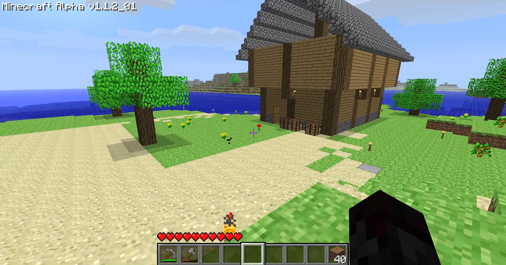
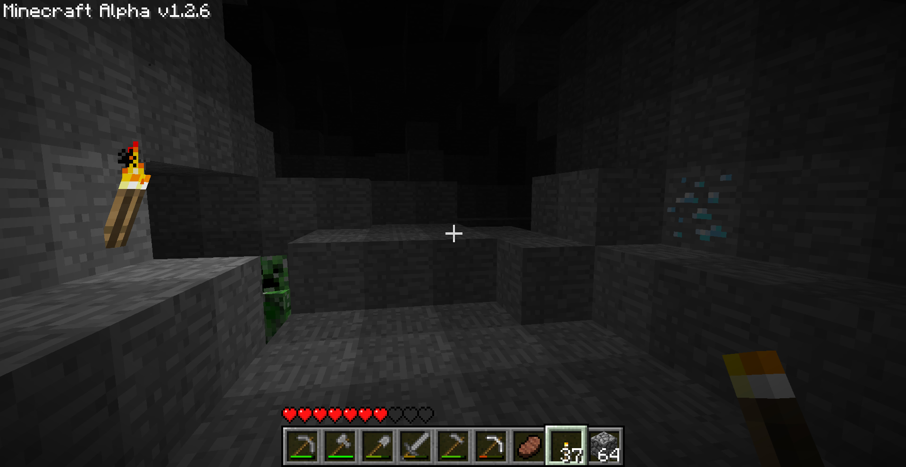
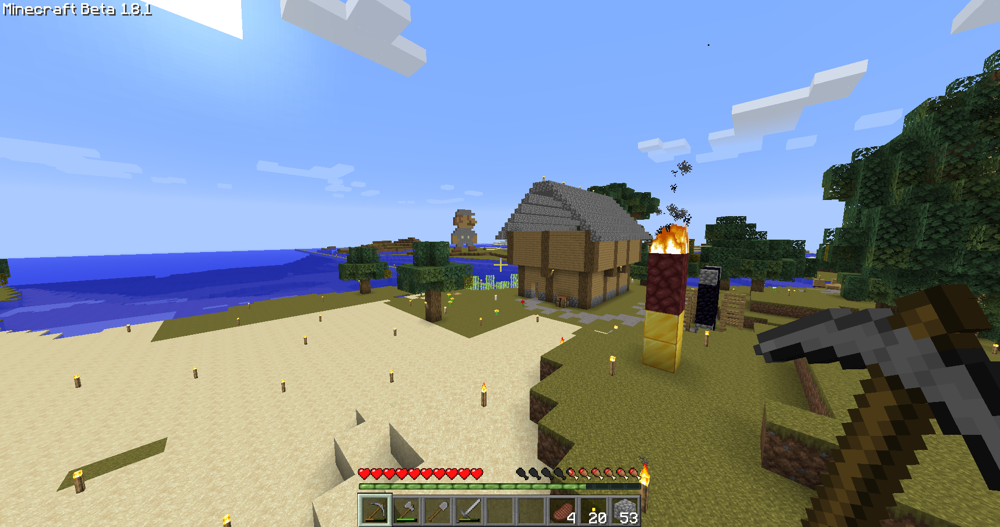

  <h1>Servidor de Minecraft Eterno</h1>
  
A premissa desse mapa é jogar com diversos amigos através de todas as versões do mine que forem possíveis e que tiveram atualizações relevantes:

<table align="center">
  <tr>
    <td valign="top">
      

        
☑ inf-20100630-1835

        
☑ a1.1.2_01

        
☑ a1.2.6

        
☑ b1.8.1
  
        
☑ 1.0

        
☐ 1.5.2

        
☐ 1.7.10

        
☐ 1.8.9

      

    

    <td valign="top">
      

        
☐ 1.9.4

        
☐ 1.12.2

        
☐ 1.13.2

        
☐ 1.14

        
☐ 1.16.5

        
☐ 1.19.4

        
☐ 1.21.11

        
☐ 26.3

      

    </td>
  </tr>
</table>

